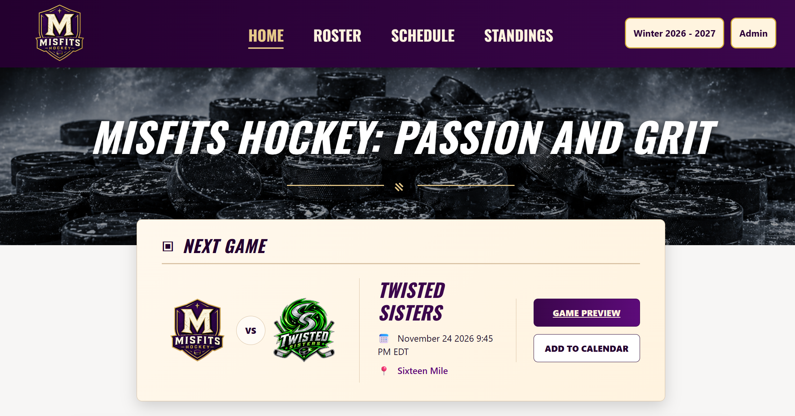
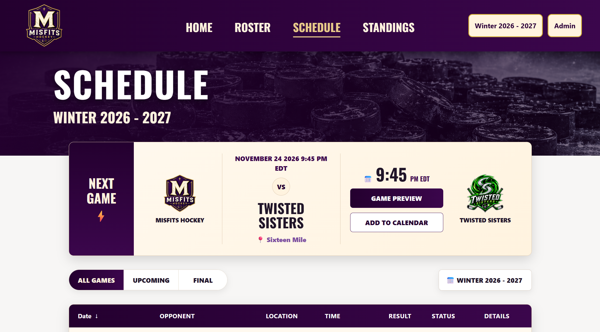
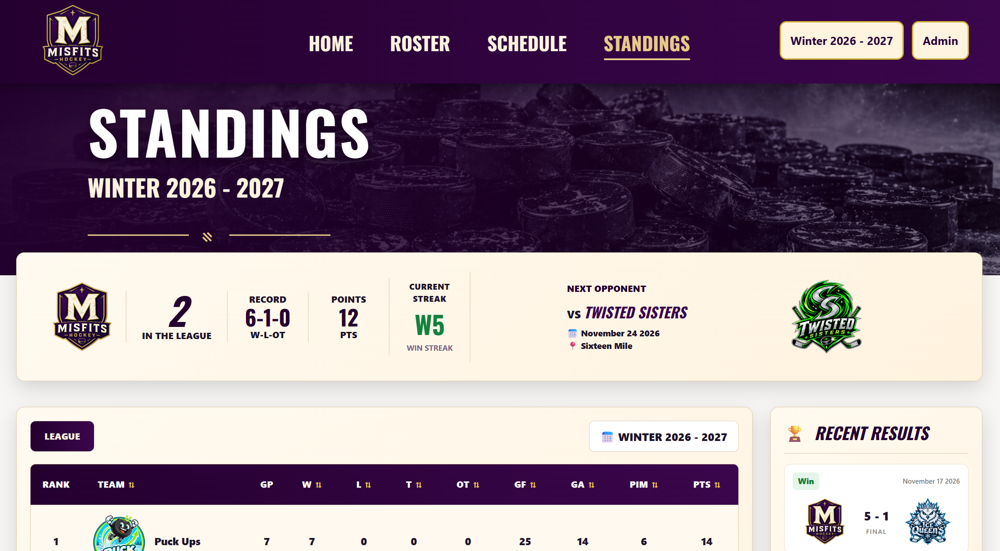
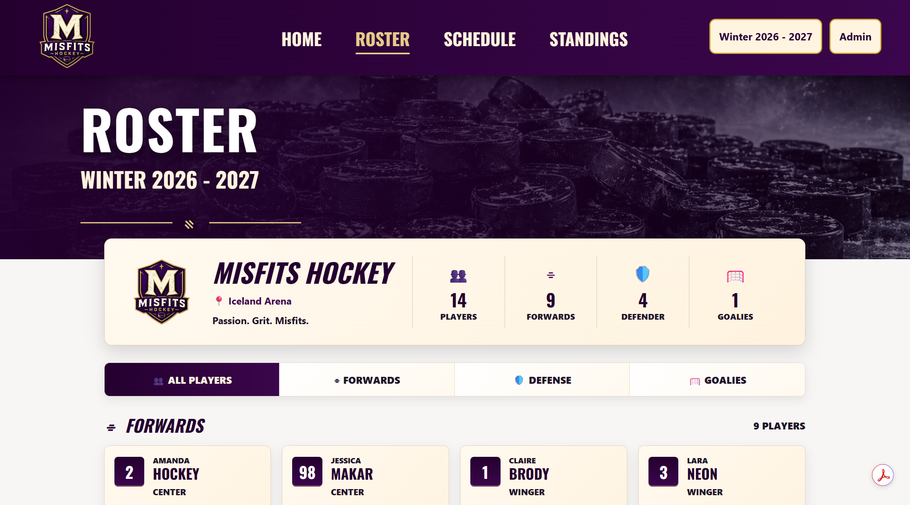

# Misfits Hockey 🏒

A full-stack hockey team management website I built to organize and keep track of my hockey team's information throughout the season.

I wanted a central place where teammates could easily check upcoming games, view results, follow the standings, and see the team roster. The website also includes an admin dashboard that allows me to manage the information without having to update the website's code every time something changes.

### 🌐 Live Website

[View Misfits Hockey](https://misfits-obo8.onrender.com)

### Features

- **Home Dashboard:** Displays upcoming games, recent results, and team information.
- **Game Schedule:** View upcoming and previous matchups, including dates, opponents, locations, and scores.
- **Standings:** Track team records, points, and rankings throughout the season.
- **Player Roster:** Browse players by position and view individual statistics.
- **Season Selection:** Switch between seasons to view the relevant information.
- **Admin Dashboard:** Add, edit, and delete games and manage team standings.
- **Authentication:** Restricts administrative features to authorized users.

### Technologies Used

| Category | Technologies |
|---|---|
| Backend | Python, Flask |
| Frontend | HTML, CSS, JavaScript, Bootstrap |
| Database | PostgreSQL, SQLAlchemy |
| Authentication | Flask-Login |
| Database Hosting | Neon |
| Web Hosting | Render |
| Testing | pytest |
| Version Control | Git, GitHub |

## Screenshots

### Home Page

### Game Schedule

### Standings

### Player Roster

### Manage Games

### Manage Standings

### What I Learned

Building Misfits Hockey gave me practical experience developing a full-stack application, from designing database models and implementing Flask routes to creating responsive interfaces and deploying a website.

I also gained experience working with a hosted PostgreSQL database, managing application configurations, and troubleshooting issues between local development and production.

### Future Improvements

- Expand player statistics and roster management features.
- Improve the mobile experience and accessibility.
- Add additional automated tests.
- Continue refining the admin dashboard.

### About the Project

Misfits Hockey is a personal project that I continue to maintain and improve as my team's needs evolve.
